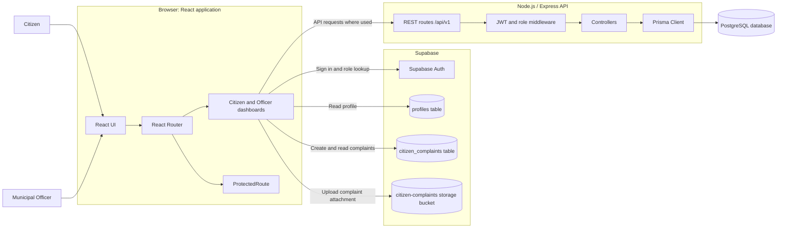
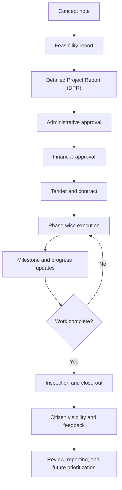

# Majhi Mati

**Phase-wise Development Monitoring and Governance System**

Majhi Mati is a citizen-facing and municipal-officer portal for viewing local development projects, tracking project phases, and handling citizen complaints. The application combines a React web client, Supabase services, and a separate Express API.

> **Project status:** This repository contains a working frontend and backend foundations, but not every screen is connected to persistent project data. Some project dashboard content is sample data. See [Current implementation notes](#current-implementation-notes) before treating it as a production system.

## Contents

- [Purpose and goals](#purpose-and-goals)
- [Architecture](#architecture)
- [Project and application workflows](#project-and-application-workflows)
- [Technology stack](#technology-stack)
- [Methodology](#methodology)
- [Repository structure](#repository-structure)
- [Requirements](#requirements)
- [Run locally from a terminal](#run-locally-from-a-terminal)
- [Database and Supabase setup](#database-and-supabase-setup)
- [API routes](#api-routes)
- [Build and validation](#build-and-validation)
- [Current implementation notes](#current-implementation-notes)
- [Security and deployment checklist](#security-and-deployment-checklist)

## Purpose and goals

The portal is intended to make municipal development work easier to follow and discuss. Its core goals are:

- Give citizens a place to view project information and submit complaints.
- Give municipal officers role-specific dashboards to review project and complaint information.
- Present development work as a sequence of approvals, delivery phases, and milestones.
- Make progress, budgets, schedules, and project information easier to understand.
- Support responsible data handling, validation, and transparency.

## Architecture

The application has two data paths. The browser communicates directly with Supabase for authentication and complaint records/uploads. It can also communicate with the Express API, whose protected routes use JWT authentication and Prisma for PostgreSQL access.



### Trust and data boundaries

- The Supabase browser client uses the project URL and **anon/public key**. Database access must be controlled by Supabase Row Level Security (RLS).
- The Express API is a separate service. Its authenticated routes expect a bearer JWT and apply route-specific role checks.
- Prisma-backed API operations require a configured PostgreSQL `DATABASE_URL` and a matching Prisma schema/database.
- A Supabase service-role key is a server-side secret and must never be added to frontend environment variables or committed to source control.

## Project and application workflows

### Government project lifecycle

The dashboard models a project as a sequence of planning, approval, procurement, delivery, and review stages. Specific project data shown in the current frontend may be sample data.



At a high level, project records can include the project name and location, scope, budget, contractor, lifecycle stage, schedule, progress, and supporting information. Do not assume that every listed field is persisted or managed through the API; see [Current implementation notes](#current-implementation-notes).

### Application request workflows

**Citizen complaint:** A citizen submits a complaint in the React dashboard. The browser can upload an attachment to the `citizen-complaints` Supabase Storage bucket, then inserts complaint details into the `citizen_complaints` table. Officers read complaint records from Supabase.

**Sign-in and role routing:** The frontend signs in using Supabase Auth, looks up the user's `profiles` row, and selects the citizen or officer view based on the stored role. `ProtectedRoute` also checks the Supabase session/local user state before displaying a dashboard.

**Express API:** Clients call the routes listed in [API routes](#api-routes). Protected requests pass through JWT authentication and role authorization before reaching a controller. Controllers use Prisma for database-backed user/issue operations. The support-token endpoints currently keep their tickets in process memory.

## Technology stack

| Area | Technologies used |
| --- | --- |
| Frontend | React, JavaScript, Vite |
| Client routing and access | React Router, `ProtectedRoute` |
| UI and visualizations | Lucide React, Frappe Gantt, RSuite Charts, CSS |
| Frontend data services | Supabase JavaScript client, Supabase Auth, Supabase Storage |
| Backend runtime and HTTP | Node.js, Express, CORS |
| API authentication | JSON Web Tokens, Passport JWT, bcryptjs |
| Database access | Prisma Client, PostgreSQL (including Supabase-hosted PostgreSQL) |
| File and messaging integrations | Multer/Cloudinary and Twilio packages/utilities |
| Development tooling | npm, Nodemon, Concurrently, Git |

## Methodology

The project follows an iterative, citizen-centric delivery approach:

1. **Understand the need:** identify citizen and municipal-officer workflows and the information each role needs.
2. **Model the governance process:** represent the project lifecycle, milestones, progress, complaint statuses, and role boundaries.
3. **Build in increments:** implement a small end-to-end user workflow at a time across the interface, API, and data service.
4. **Validate data and access:** check inputs and project-data integrity; apply server-side authorization and database access policies.
5. **Verify changes:** build the frontend and manually exercise the relevant citizen, officer, and API paths.
6. **Improve from feedback:** refine clarity, accessibility, reliability, and reporting based on user and municipal feedback.

This describes the development approach; the repository does not currently define an automated test suite or CI pipeline.

## Repository structure

```text
majhi-mati/
├── frontend/
│   ├── src/
│   │   ├── components/       # Shared UI and route protection
│   │   ├── lib/              # Supabase browser client
│   │   ├── pages/            # Login and citizen/officer dashboards
│   │   ├── data/             # Frontend project/task data
│   │   └── utils/            # Project-data validation
│   ├── public/               # Public assets
│   └── vite.config.js
├── backend/
│   ├── config/               # Database, Supabase, and auth configuration
│   ├── controllers/          # API request handlers
│   ├── middleware/           # JWT, role, and error handling
│   ├── routes/               # Express route definitions
│   ├── utils/                # Cloudinary/SMS utilities
│   └── server.js             # Express application entry point
├── supabase/
│   └── schema.sql            # Complaint table, policies, and storage bucket
├── package.json              # Root scripts, including combined development run
└── README.md
```

## Requirements

- Node.js and npm installed.
- A Supabase project for the frontend authentication, profile lookup, complaint table, and optional file storage flows.
- A PostgreSQL database and a matching Prisma schema/database setup for Prisma-backed API endpoints.
- Optional credentials for Cloudinary or Twilio if those integrations are enabled.

Use a currently supported Node.js LTS release compatible with the Vite version installed from the lockfile.

## Run locally from a terminal

Use PowerShell for the commands below. Replace placeholder values with credentials from your own development services; never paste secrets into source files or commit `.env` files.

### 1. Get the repository and install dependencies

For a fresh clone, run this from the parent directory where you want the project folder created:

```powershell
git clone https://github.com/Taufik7860/majhi-mati.git
cd majhi-mati
```

If the repository is already cloned, go to its root instead:

```powershell
cd C:\majhi-mati
```

Install the root, frontend, and backend dependencies:

```powershell
# Install root tools, including Concurrently
npm install

# Install frontend and backend packages
npm install --prefix frontend
npm install --prefix backend
```

### 2. Configure the frontend environment

Create `frontend/.env` and add the Supabase project URL and anon/public key:

```powershell
notepad frontend\.env
```

File contents (replace the placeholders):

```dotenv
VITE_SUPABASE_URL=https://YOUR_PROJECT_ID.supabase.co
VITE_SUPABASE_ANON_KEY=YOUR_SUPABASE_ANON_PUBLIC_KEY
```

Vite exposes variables prefixed with `VITE_` to browser code. Only use the Supabase anon/public key here; never put a service-role key in this file.

### 3. Configure the backend environment

Create `backend/.env`:

```powershell
notepad backend\.env
```

Set the values needed by your local PostgreSQL/JWT setup:

```dotenv
PORT=5000
DATABASE_URL=postgresql://DB_USER:DB_PASSWORD@DB_HOST:5432/DB_NAME
JWT_SECRET=REPLACE_WITH_A_LONG_RANDOM_SECRET
JWT_EXPIRES_IN=7d
NODE_ENV=development
```

If you enable the optional Cloudinary or Twilio integrations, configure their credentials on the backend only:

```dotenv
CLOUDINARY_CLOUD_NAME=
CLOUDINARY_API_KEY=
CLOUDINARY_API_SECRET=
TWILIO_ACCOUNT_SID=
TWILIO_AUTH_TOKEN=
TWILIO_PHONE_NUMBER=
```

Do not commit either `.env` file. Use the provider's dashboard to obtain credentials and use a unique, strong `JWT_SECRET` for each environment.

### 4. Set up Supabase

1. In the Supabase SQL Editor, run the SQL in [`supabase/schema.sql`](./supabase/schema.sql) to create the complaint table and storage bucket.
2. Configure Supabase Authentication and create/maintain the `profiles` table used by the login page. The repository SQL file does not create that profile table.
3. Confirm the frontend environment values belong to the same Supabase project.
4. Review the policies in the SQL file. They allow public read/insert access for complaints and public read/upload access to the complaint bucket; tighten these policies before using real or sensitive data.

### 5. Start the application

**Recommended: run frontend and API together** from the repository root:

```powershell
npm start
```

- Frontend: `http://localhost:5173`
- Backend health endpoint: `http://localhost:5000/`

**Run in separate terminals** if you want independent logs or to start only one process:

```powershell
# Terminal 1 - frontend
cd C:\majhi-mati
npm run dev:frontend
```

```powershell
# Terminal 2 - backend
cd C:\majhi-mati
npm run dev:backend
```

The frontend-only command is also available directly:

```powershell
cd C:\majhi-mati
npm run dev --prefix frontend
```

The backend package starts with `npm start --prefix backend`; during development, use `npm run dev --prefix backend` for Nodemon.

## Database and Supabase setup

The repository uses separate persistence paths:

- **Browser-side Supabase:** login/profile lookup, complaint inserts/reads, and complaint attachment uploads.
- **Backend Prisma:** user and issue queries against PostgreSQL, configured with `DATABASE_URL`.
- **Backend support tokens:** currently held in server memory and lost when the API process restarts.

The checked-in [`supabase/schema.sql`](./supabase/schema.sql) creates `public.citizen_complaints`, its basic row-level policies, and the `citizen-complaints` storage bucket. It is not a complete database schema for every API model or frontend query. In particular, the login flow expects a `profiles` table, and Prisma-backed routes need a Prisma schema and database tables that match their models.

## API routes

The backend listens on port `5000` by default. Its API routes are mounted under `/api/v1`.

| Method | Path | Access | Purpose |
| --- | --- | --- | --- |
| `GET` | `/` | Public | API status response |
| `POST` | `/api/v1/auth/login` | Public | Sign in and issue an API JWT |
| `POST` | `/api/v1/auth/register` | Public | Register a user |
| `GET` | `/api/v1/auth/me` | Bearer JWT | Get the authenticated user's profile |
| `GET` | `/api/v1/user/dashboard` | Bearer JWT; citizen/admin roles | Get issue summary for the current user |
| `GET` | `/api/v1/municipal/dashboard-stats` | Bearer JWT; municipal/super admin roles | Get issue statistics and recent issues |
| `PATCH` | `/api/v1/municipal/issues/:id/status` | Bearer JWT; municipal/super admin roles | Update an issue status |
| `POST` | `/api/v1/support/token` | Public | Create an in-memory support ticket/token |
| `GET` | `/api/v1/support/tokens` | Public | List in-memory support tickets |

For protected API routes, send:

```http
Authorization: Bearer YOUR_API_JWT
```

## Build and validation

Build the frontend for production:

```powershell
cd C:\majhi-mati
npm run build --prefix frontend
```

Preview the production build locally:

```powershell
cd C:\majhi-mati
npm run preview --prefix frontend
```

The frontend development server runs on port `5173`. The backend package currently defines start/dev and Prisma generate/push scripts, but no test or lint script is defined in the package manifests.

## Current implementation notes

- The citizen and officer dashboards include local/sample project records; do not treat those records as a live centralized project registry.
- Complaint creation and officer complaint listing use Supabase directly. Database access therefore depends on the project URL, anon key, table/bucket setup, and RLS policies.
- Frontend login reads Supabase Auth and then looks up a row in `profiles`. The checked-in SQL does not create `profiles`.
- The Express API is a separate path from the dashboard's direct Supabase calls. Its user/issue operations use Prisma and require database models/tables compatible with the controllers.
- The support-token API stores tickets in an in-memory array; tickets are not durable and are not the same persistence path as `citizen_complaints`.
- The repository does not include a backend Prisma schema or complete migrations for the API's user/issue models. Database provisioning for those routes must be completed before relying on them.
- Review backend Supabase configuration against Node.js environment handling before relying on the API's Supabase Auth calls; the frontend and backend run in different environments.

## Security and deployment checklist

- Keep `.env` files, database passwords, JWT secrets, Supabase service-role keys, and provider secrets out of Git.
- Never expose Supabase service-role credentials in the Vite frontend. The anon key is intended for browser use only when RLS is correctly configured.
- Replace development defaults, enforce strong server-side secrets, and use HTTPS in production.
- Restrict complaint-table and storage policies to the intended user/officer roles before storing personal data.
- Validate and authorize all API writes on the server; frontend route guards are not a security boundary.
- Move in-memory support tickets to durable storage before production use.
- Configure production CORS origins, error handling, logging, database migrations, backups, and monitoring before deployment.
